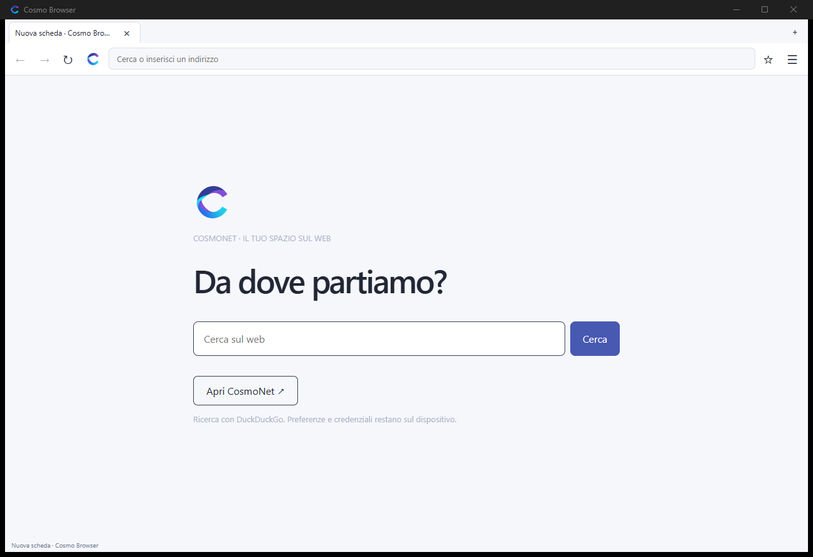

# Cosmo Browser


**Browser gratuito per uso personale, in sviluppo per Windows e Android.** Core in Rust, interfaccia Tauri 2 e navigazione in webview native: Microsoft WebView2 su Windows, Android WebView sul telefono. La versione Linux è rimandata.

Il progetto usa i motori già aggiornati dal sistema e **non compila un fork completo di Chromium**. Questo permette build sui runner standard gratuiti di GitHub Actions, senza server a pagamento o checkout del motore da 100 GB. I moduli CosmoNet sono componenti propri: non equivalgono al supporto completo delle estensioni Chrome.

**Versione di sviluppo: [0.3.2](https://github.com/CosmoNetinfo/cosmonet-browser/releases/tag/v0.3.2).** Corregge le pagine web che potevano coprire Impostazioni e altri pannelli nella 0.3.1. La [build Windows e Android è riuscita](https://github.com/CosmoNetinfo/cosmonet-browser/actions/runs/46055964573). La portable scaricata ha superato navigazione HTTP, gestione schede e controllo della visibilità effettiva delle WebView durante i pannelli. L'APK ha superato checksum, firma e verifica identità, mantenendo il certificato delle versioni precedenti. La verifica della correzione sul telefono resta necessaria. Per questa patch scaricare il file APK: il difetto della 0.3.1 può coprire anche i comandi dell'updater.

## Schermate reali

Queste immagini provengono dalla finestra dell'app Windows, con profilo di test isolato. Sono catture del rendering dell'app, non mockup o immagini del desktop. Le schermate Android verranno aggiunte dopo il collaudo su dispositivo o emulatore.

### Windows · tema chiaro



### Windows · tema scuro


### Windows · Impostazioni


## Download di sviluppo: installer, portable e APK

La **[release v0.3.2](https://github.com/CosmoNetinfo/cosmonet-browser/releases/tag/v0.3.2)** contiene installer Windows, portable, APK Android, guida di installazione e `SHA256SUMS`. È una pre-release di sviluppo. Le [note dettagliate](docs/releases/v0.3.2.md) riportano correzione, verifiche e limiti. I file pubblicati nella release restano disponibili oltre la scadenza degli artefatti Actions.

Per le build successive aprire [GitHub Actions → Build Windows installer and Android APK](https://github.com/CosmoNetinfo/cosmonet-browser/actions/workflows/build-apps.yml), scegliere un'esecuzione **riuscita** e scorrere fino ad **Artifacts**:

| Artefatto | Contenuto | Note |
| --- | --- | --- |
| `Cosmo-Browser-Windows` | Installer NSIS `.exe`, `Cosmo-Browser-Portable.exe`, checksum SHA-256 | Windows x64, nessun certificato commerciale |
| `Cosmo-Browser-Android` | APK ARM64 firmato con chiave personale e checksum | Android 9 o successivo; collaudo su dispositivo necessario |

Per scaricare gli artefatti Actions può essere necessario accedere a GitHub. Le build sono conservate per 7 giorni: non sono ancora un canale stabile di aggiornamento o una release finale. Un job fallito non produce un pacchetto verificato.

L'installer Windows verifica/installa WebView2 tramite il bootstrapper Microsoft. La portable usa il runtime WebView2 presente nel sistema e conserva i dati nella cartella applicativa dell'utente: **portable non significa che il profilo sia contenuto nell'eseguibile**. L'assenza di firma commerciale può generare avvisi Windows; non disabilitare le protezioni del sistema per ignorarli.

Android richiede una firma per installare qualsiasi APK. Il progetto usa una chiave personale gratuita, conservata fuori dalla repository e fornita alla CI tramite GitHub Secrets cifrati. La stessa chiave deve essere conservata per poter aggiornare l'app senza cambiarne identità. Non serve acquistare un certificato.

## Caratteristiche e stato reale

| Funzione | Implementazione | Verifica / limite |
| --- | --- | --- |
| Core Rust e Tauri 2 | Comandi nativi validati, dati locali, gestione schede | Compilazione Windows e Android ARM64 riuscita |
| Schede native integrate | Viste figlie nella finestra Windows; WebView native nel plugin Android | Test Windows: due schede create, attivate e chiuse |
| Navigazione senza iframe | HTTP/HTTPS in WebView2 / Android WebView | Non aggira restrizioni OAuth, DRM o policy dei siti |
| Barra indirizzi e ricerca | Navigazione, ricerca DuckDuckGo, URL e titolo aggiornati dal motore | Indietro/avanti nativi, ricarica e home |
| Preferiti e cronologia | Memorizzazione locale, apertura e cancellazione | Nessun account cloud del browser |
| Temi | Sistema, chiaro, scuro e sabbia | Interfaccia e home; i siti mantengono il proprio aspetto |
| Impostazioni | Tema, motore di ricerca, cronologia, password e aggiornamenti | Preferenze salvate sul dispositivo |
| Mobile Android | Viewport mobile, controlli touch e modalità sito desktop per scheda | La modalità predefinita delle nuove schede è configurabile |
| Logo e favicon Cosmo Browser | C orbitale nei colori CosmoNet, icone PNG e ICO | Integrati nell'app e nelle risorse Android |
| Password Windows | Archivio cifrato con DPAPI, legato all'utente Windows | Test di cifratura, decifratura e rilevamento corruzione riusciti |
| Password Android | AES-256-GCM con chiave Android Keystore; backup app disabilitato | Implementato, da collaudare sul dispositivo |
| Gestione password | Inserimento manuale, elenco senza valori segreti, cancellazione e compilazione su clic | Solo siti HTTPS e origine esatta; nessun autosalvataggio dichiarato |
| Moduli CosmoNet | Primo modulo: Lettura CosmoNet, limitato a cosmonet.info | Non ha accesso all'archivio credenziali |
| Debug | DevTools nativi Windows e console Eruda inclusa localmente | Niente caricamento della console da CDN |
| Download Android | DownloadManager, cartella download dell'app | Da verificare su telefono; nessuna esecuzione automatica dei file |
| Installer e APK | Workflow su runner GitHub standard | Prima build completa riuscita; firma APK e checksum verificati |
| Aggiornamenti del browser | Controllo all'avvio o manuale, download verificato e apertura installer | Introdotti dalla 0.3.1; conferma Android obbligatoria |
| Versione Linux | Rimandata | Ubuntu in Actions serve solo come macchina di compilazione Android |

### Leggerezza, RAM e tempi di avvio

La build 0.3.2 del commit `813cdcf`, prodotta da GitHub Actions e scaricata per il collaudo, misura **4.853.248 byte (~4,85 MB) per la portable** e **1.664.310 byte (~1,66 MB) per l'installer**. La portable è stata avviata da una cartella separata e ha superato il test di navigazione HTTP, indietro/avanti, gestione schede e visibilità nativa dei pannelli. Queste dimensioni escludono il runtime WebView2 condiviso con il sistema e i dati del profilo; possono cambiare nelle build successive.

L'APK ARM64 0.3.2 misura **7.379.827 byte (~7,38 MB)**, richiede Android 9+ e usa l'identificativo `info.cosmonet.browser`, versione `0.3.2` (versionCode `3002`). La firma personale APK v2 è stata verificata anche dopo il download ed è la stessa delle versioni precedenti. L'APK include il codice dell'app; il motore Android WebView è fornito e aggiornato dal sistema.

La dimensione dell'eseguibile non misura la RAM: ogni scheda può usare processi del runtime. Non sono ancora pubblicati benchmark ripetibili di memoria o avvio sotto un secondo. Le future misure includeranno 1/10/30 schede, CPU inattiva, riproduzione video e hardware Android reale.

### Compatibilità dei siti

La navigazione avviene in viste native, quindi non dipende dal permesso di un sito di essere caricato in un iframe. Questo evita i limiti degli iframe, ma **non garantisce un “bypass totale”**: alcuni accessi Google/OAuth, contenuti DRM e servizi possono rifiutare browser incorporati. Android usa normalmente lo user agent WebView del dispositivo; l'opzione esplicita “Sito desktop” richiede la variante desktop cambiando lo user agent della scheda. Sandbox, controlli TLS e sicurezza web restano attivi.

### Aggiornamenti dalla 0.3.1

Aprire **Menu → Impostazioni → Aggiornamenti**. Il controllo all'avvio è attivo per impostazione predefinita e si può disattivare. Contatta l'API pubblica GitHub, senza inviare password, cronologia o preferiti, e include le pre-release pubblicate con una versione numerica superiore e un pacchetto per la propria piattaforma. Il download parte su clic, non in background.

Il componente nativo accetta solo pacchetti della repository CosmoNetinfo/cosmonet-browser, con nome previsto, dimensione limitata e digest SHA-256 pubblicato da GitHub. Rifiuta versioni uguali o inferiori. Android verifica anche identità del pacchetto, versionCode e certificato uguale a quello dell'app installata. L'APK passa all'installer tramite un FileProvider limitato alla cartella privata degli aggiornamenti.

Su Android occorre confermare l'installazione nella schermata di sistema; se necessario autorizzare Cosmo Browser come sorgente, poi tornare e premere di nuovo **Installa aggiornamento**. La 0.3.0 non include il controllo: **la prima installazione della 0.3.1 deve essere manuale**, sopra l'app esistente e con la stessa firma, senza disinstallare per conservare i dati. Su Windows l'azione chiude il browser e avvia l'installer, anche se si sta usando la portable; non sostituisce silenziosamente l'eseguibile portable.

Il runtime WebView2/Android WebView continua ad aggiornarsi tramite il sistema: è distinto dalle release dell'app Cosmo Browser. Il flusso UI è verificato con un ponte nativo simulato; l'installazione completa su Android richiede ancora collaudo sul dispositivo.

## Password e sicurezza

Le credenziali sono conservate in un archivio cifrato sul dispositivo. L'app non offre login del browser o sincronizzazione dell'archivio con servizi cloud.

- **Windows:** DPAPI protegge il contenuto per l'utente Windows corrente. Il file è `credentials.dpapi` in `%LOCALAPPDATA%\info.cosmonet.browser`, fuori dalla cartella dei profili itineranti. L'app sposta qui l'eventuale archivio cifrato delle prime build se la destinazione è assente; non sovrascrive un archivio locale esistente. Non viene importato il vecchio `passwords.json`.
- **Android:** una chiave AES nel Keystore cifra l'archivio `cosmo-vault.aes` nella directory privata dell'app. Il manifest disabilita il backup dell'app. Un archivio esistente senza la relativa chiave non viene sovrascritto silenziosamente.
- Il salvataggio iniziale è manuale dal pannello **Password locali**. Le password non vengono mostrate negli elenchi né restituite dal comando che elenca gli accessi.
- La compilazione richiede un clic, HTTPS, corrispondenza dell'origine del sito e un secondo controllo dell'origine nello script. Non invia automaticamente il modulo di login.
- Le WebView dei siti non ricevono le API Tauri dell'interfaccia. I comandi Rust verificano anche etichetta e origine della UI locale. Il plugin Android non aggiunge interfacce JavaScript native ai contenuti dei siti.
- I dati di preferiti e cronologia restano in un JSON locale, perché non sono l'archivio delle credenziali. Non inserirvi password.

Nessun browser può essere sicuro al 100%. Un sistema compromesso, malware nell'account dell'utente o un sito malevolo dopo la compilazione dei suoi campi restano rischi reali. Il percorso Android necessita ancora di verifiche runtime e non è presentato come un vault già certificato. Fotocamera, microfono e caricamento file richiedono lavoro aggiuntivo: le richieste dei siti non vengono autorizzate indiscriminatamente.

Leggere [SECURITY.md](SECURITY.md) per scansione dei segreti e stato degli avvisi. Le segnalazioni GitGuardian devono essere verificate nei singoli dettagli; gli hash pubblici dei sorgenti non sono password. Nessuna credenziale reale deve essere “risolta” soltanto cancellandola dal ramo corrente: se confermata, va revocata o ruotata.

## Moduli ed estensioni proprietarie

Il primo modulo è in `modules/cosmonet-reader/`: il suo manifest dichiara identità, versione e origini consentite. Il comando nativo verifica l'origine effettiva prima di attivarlo. Il modulo applica una presentazione più leggibile agli articoli CosmoNet e può essere disattivato richiamandolo.

Un modulo non riceve accesso libero a file, chiavi o credenziali. I nuovi moduli vanno aggiunti con una funzione precisa e permessi verificabili. L'installazione arbitraria di moduli di terzi, una sandbox di estensioni e un catalogo non sono ancora implementati.

L'estensione desktop separata **Cosmo Home** in `extensions/cosmo-home/` resta disponibile per browser Chromium compatibili. Offre nuova scheda, temi, collegamenti e preferenze in `chrome.storage.local`, senza accesso ai siti visitati. Non è la prova che Cosmo Browser supporti tutte le estensioni Chrome, né che le estensioni desktop funzionino su Android.

## Build gratuite con GitHub Actions

Il workflow principale è [.github/workflows/build-apps.yml](.github/workflows/build-apps.yml). Si avvia con push di codice su `main` o dal pulsante **Run workflow**:

1. Controlla i modelli JavaScript e scansiona l'intera cronologia con Gitleaks, oscurando i valori rilevati.
2. Su `windows-latest`, compila Rust, verifica DPAPI, genera installer NSIS e portable, quindi esegue il test dell'app con WebView2 reale.
3. Su `ubuntu-24.04`, installa SDK/NDK Android, compila il core Rust per ARM64 e il plugin nativo, firma l'APK con la chiave personale e ne verifica la firma.
4. Carica i pacchetti e i checksum come artefatti di sviluppo. La chiave temporanea Android viene eliminata dal runner anche in caso di errore.

Questa configurazione usa runner **standard**, non runner più grandi a pagamento o macchine self-hosted. Per le repository pubbliche l'esecuzione standard è gratuita; conservazione degli artefatti e quote dell'account vanno comunque controllate. Non sono previsti servizi cloud di sincronizzazione, pubblicità, abbonamenti o vendite del browser.

Le credenziali tecniche di firma sono nei Secrets `COSMO_ANDROID_KEYSTORE_B64` e `COSMO_ANDROID_STORE_PASSWORD`. I nomi non sono segreti; i valori non devono comparire nei file, negli output o negli artefatti. L'account che mantiene la repository deve conservare una copia privata della chiave e della password, esterna al progetto.

Il vecchio workflow per un fork completo di Chromium è archiviato in `legacy/workflows/` e non è la pipeline corrente. La cartella `chromium/` conserva esperimenti e controlli sui sorgenti, non viene compilata per generare questa versione.

Riferimenti: [costi Actions](https://docs.github.com/en/actions/concepts/billing-and-usage), [Tauri](https://v2.tauri.app/), [sicurezza WebView2](https://learn.microsoft.com/en-us/microsoft-edge/webview2/concepts/security).

## Sviluppo locale

### Struttura

```text
app/                         Interfaccia del browser e home inclusa nell'app
app/vendor/                  Console Eruda locale e relativa licenza
src-tauri/src/               Core Rust, schede desktop e archivio DPAPI
src-tauri/plugins/browser/   Plugin WebView/Keystore Android
src-tauri/gen/android/       Progetto Android e configurazione di firma
modules/                     Moduli CosmoNet propri
branding/                    Master del logo, prompt e icone esportate
docs/screenshots/            Schermate reali verificate
extensions/, themes/         Cosmo Home e temi Chromium separati
tools/, tests/               Preparazione, test, scansioni e strumenti di build
legacy/, chromium/           Riferimenti storici e sperimentali
.work/                       Report e file locali esclusi da Git
```

I vecchi `src-web/`, `www/` e documenti di stato descrivono il prototipo precedente. Il frontend corrente è `app/`; il vecchio eseguibile nella radice non rappresenta la versione 0.3.0.

### Windows

Servono Node.js 22+, Python, Rust stabile, strumenti C++ Microsoft per lo sviluppo desktop, SDK Windows e WebView2. Non è richiesto l'ambiente da 100 GB usato per compilare Chromium.

```powershell
git clone https://github.com/CosmoNetinfo/cosmonet-browser.git
cd cosmonet-browser
npm ci --ignore-scripts
npm run prepare:app
npm start
```

Compilazione e test:

```powershell
npm test
cargo test --manifest-path src-tauri/Cargo.toml --lib --locked
npm run build:windows
node tools/native-smoke.cjs
```

Il test nativo usa un profilo e una directory WebView2 isolati; verifica caricamento, creazione, attivazione e chiusura delle viste contenuto. Il report resta in `.work/`. L'output Windows è in `src-tauri/target/release/bundle/nsis/`; l'eseguibile standalone è `src-tauri/target/release/cosmo-browser.exe`.

### Android

Per ottenere l'APK **non serve Linux sul proprio PC**: può compilarlo GitHub Actions su Ubuntu. Per compilare localmente servono JDK, SDK Android 36, Build Tools 36, NDK 28.2.13676358 e il target Rust `aarch64-linux-android`, con `JAVA_HOME`, `ANDROID_HOME` e `NDK_HOME` configurati.

```sh
npm ci --ignore-scripts
npm run prepare:app
rustup target add aarch64-linux-android
npm run build:android
```

Una compilazione locale release senza configurazione di firma può produrre un APK non installabile. Usare la chiave personale tramite ambiente locale protetto oppure `npm exec tauri -- android build --debug --apk --target aarch64 --ci` per un test di sviluppo. Chiavi debug diverse non permettono aggiornamenti trasparenti tra build: non disinstallare un'app con dati importanti senza aver prima valutato come conservarli.

L'APK è sotto `src-tauri/gen/android/app/build/outputs/apk/`. Le build sono ARM64; emulatori x86 e dispositivi ARM a 32 bit richiedono target aggiuntivi. Android 9 è il minimo configurato, non una certificazione di funzionamento su tutti i dispositivi.

### Test accessori e sicurezza

```sh
npm run secrets:scan
npm run extensions:pack
npm exec playwright install chromium
npm run test:browser
```

Gitleaks viene scaricato dalla release ufficiale fissata e verificato tramite checksum. Il report è oscurato e non viene caricato come artefatto pubblico. I test Playwright riguardano l'estensione Cosmo Home; non sostituiscono i test del browser nativo.

## Logo, favicon e schermate

La C orbitale riprende blu, ciano e viola del marchio CosmoNet. È stata creata con ImageGen; il prompt completo è in [branding/logo-prompt.txt](branding/logo-prompt.txt). Il master trasparente è `branding/cosmo-browser-master.png`; PNG da 16 a 1024 pixel e ICO multirisoluzione sono in `branding/icons/`. Le favicon sono anche disponibili nella radice come `favicon.ico` e `favicon.png`.

Per esportare le dimensioni dal master usare `node tools/python.cjs tools/build-brand-icons.py` con Pillow nell'ambiente di sviluppo, poi `npm run prepare:app`. Le normali build non richiedono Pillow perché le icone esportate sono già versionate.

Le schermate Windows sono state acquisite dal rendering diretto della sola finestra del browser, dopo il test nativo, con dati di prova. Il tool `capture-native-window.py` non usa una cattura del desktop come ripiego. Per riprodurle, con Pillow disponibile:

```powershell
node tools/native-smoke.cjs src-tauri/target/release/cosmo-browser.exe --capture
node tools/native-smoke.cjs src-tauri/target/release/cosmo-browser.exe --capture --dark
```

## Prossime tappe

- Collaudo Android su emulatore/dispositivo: navigazione, tastiera, rotazione, tasto indietro, download, archivio locale e aggiornamento con la stessa chiave.
- Test più estesi su siti reali, popup, login, PDF, file upload e permessi dei siti.
- Misure ripetibili di dimensione, avvio e RAM; gestione della sospensione delle schede.
- Autosalvataggio password con conferma e gestione corretta delle origini, prima di dichiararlo disponibile.
- Altri moduli CosmoNet, personalizzazione dei temi e accessibilità.
- Aggiornamenti del browser verificabili. Linux resta fuori dalla prima fase.

La finalità “le caratteristiche migliori dei browser” viene tradotta in funzioni concrete e collaudabili; non è una promessa che tutte siano già presenti.

## Uso personale, licenza e contributi

Cosmo Browser è pensato come progetto gratuito per uso personale, senza funzioni di vendita. Il vecchio manifest dichiara MIT, ma la licenza del progetto deve ancora essere formalizzata in un file `LICENSE`: questa fase non introduce nuove restrizioni sul codice. Le dipendenze mantengono le proprie licenze; la licenza Eruda è inclusa in `app/vendor/ERUDA-LICENSE.txt`.

Per contribuire, aprire una issue o una pull request con problema, modifica e verifiche eseguite. Non allegare archivi password, profili personali, chiavi di firma o token.

[Repository](https://github.com/CosmoNetinfo/cosmonet-browser) · [CosmoNet](https://www.cosmonet.info/) · [Sicurezza](SECURITY.md)
