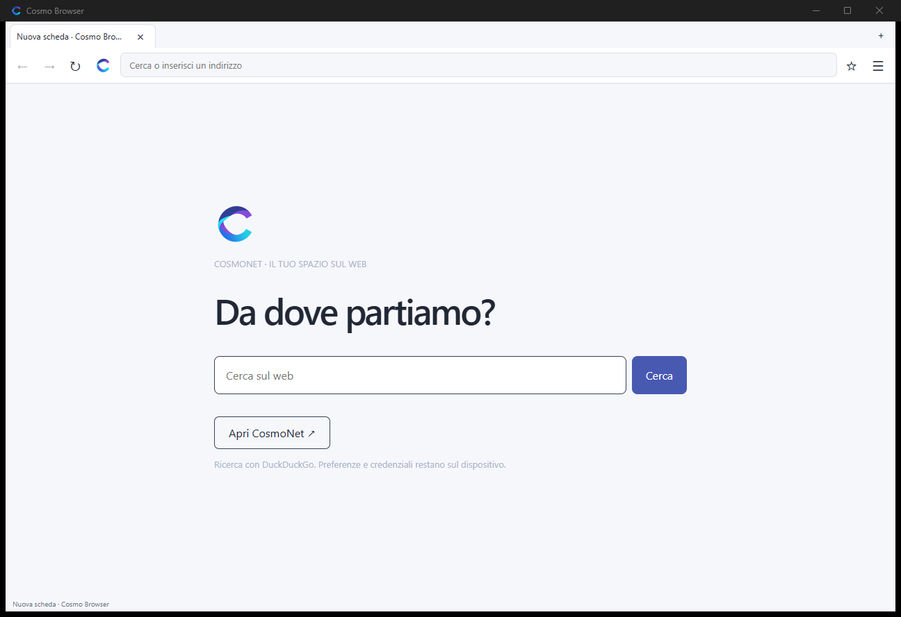
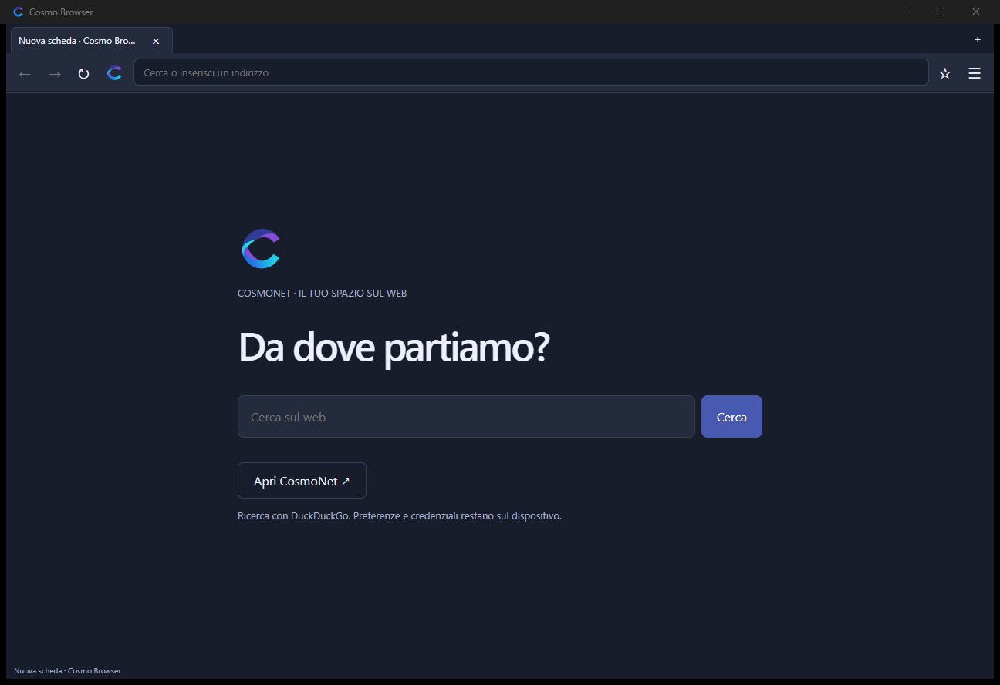

# Cosmo Browser 0.3.0 — Windows e Android

Prima anteprima pubblica del nuovo Cosmo Browser con core Rust, Tauri 2 e webview native. Gratuito per uso personale. Questa è una **pre-release di sviluppo**, con Windows collaudato e Android ancora da verificare durante l'uso su dispositivo.

## Download

Scaricare i file dalla [release v0.3.0](https://github.com/CosmoNetinfo/cosmonet-browser/releases/tag/v0.3.0):

| File | Piattaforma | Dimensione |
| --- | --- | --- |
| `Cosmo-Browser-0.3.0-Windows-x64-Setup.exe` | Installer Windows x64 | 1.460.508 byte (~1,46 MB) |
| `Cosmo-Browser-Portable.exe` | Portable Windows x64 | 4.267.520 byte (~4,27 MB) |
| `Cosmo-Browser-0.3.0-Android-arm64.apk` | Android 9+, ARM64 | 7.356.835 byte (~7,36 MB) |
| `README-Cosmo-Browser-0.3.0.md` | Questa guida, scaricabile separatamente | — |
| `SHA256SUMS` | Checksum dei tre pacchetti e della guida | — |

I pacchetti della release restano disponibili oltre la scadenza degli artefatti Actions. Le dimensioni escludono il runtime WebView2/Android WebView e i dati del profilo.

## Installazione Windows

1. Usare Windows x64 con supporto a Microsoft WebView2; è consigliato Windows 11 aggiornato.
2. Per l'installazione guidata aprire `Cosmo-Browser-0.3.0-Windows-x64-Setup.exe`. L'installer verifica il runtime WebView2 e può scaricarlo da Microsoft: in tal caso serve Internet.
3. In alternativa avviare `Cosmo-Browser-Portable.exe`: non richiede installazione dell'app, ma richiede WebView2 già presente.

I file Windows non hanno un certificato commerciale. Windows potrebbe mostrare avvisi di reputazione. Verificare provenienza e checksum, senza disabilitare le protezioni del sistema.

La portable conserva preferenze e password nella cartella locale dell'utente, non dentro l'eseguibile. L'archivio credenziali è `%LOCALAPPDATA%\info.cosmonet.browser\credentials.dpapi`, protetto da DPAPI per l'utente Windows corrente. L'app sposta l'eventuale archivio cifrato delle prime build nella cartella locale quando la destinazione è assente. Non importa il vecchio `passwords.json`.

## Installazione Android

1. Usare un dispositivo **Android 9 o successivo, ARM64**. Il nome del pacchetto è `info.cosmonet.browser`, versione `0.3.0` (versionCode `3000`).
2. Scaricare `Cosmo-Browser-0.3.0-Android-arm64.apk` e aprirlo dal dispositivo.
3. Se richiesto, autorizzare l'installazione da quella specifica applicazione sorgente nelle impostazioni Android; al termine è possibile revocare tale autorizzazione.

L'APK è firmato con una chiave personale gratuita Cosmo Browser/CosmoNet. Non è una distribuzione tramite Play Store. Gli aggiornamenti devono usare la stessa chiave; non disinstallare un'app con dati importanti per aggirare un conflitto di firma. Il motore di navigazione è Android WebView: mantenerlo aggiornato tramite i canali del sistema.

Le password Android sono cifrate con AES-256-GCM e una chiave nel Keystore; il backup dell'app è disabilitato. **Questa implementazione non è ancora collaudata durante l'uso su telefono o emulatore.**

## Funzionalità incluse

- Schede in webview native, fino a 32, senza iframe per la navigazione dei siti.
- Barra indirizzi, ricerca DuckDuckGo, indietro/avanti, ricarica e pagina iniziale CosmoNet.
- Preferiti e cronologia locali, senza account di sincronizzazione del browser.
- Temi sistema, chiaro, scuro e sabbia; logo e favicon Cosmo Browser.
- Password locali: salvataggio manuale, elenco senza segreti, cancellazione e compilazione su clic, solo su HTTPS e per l'origine esatta.
- Modulo Lettura CosmoNet, limitato ai domini CosmoNet autorizzati.
- DevTools Windows e console Eruda inclusa nell'app, senza CDN.
- DownloadManager Android per i download; da verificare su dispositivo.

## Schermate Windows reali





## Verifiche della release

I tre pacchetti provengono dalla [build GitHub Actions riuscita](https://github.com/CosmoNetinfo/cosmonet-browser/actions/runs/46011368944), commit `fbb4138872150d555e42e7184245014d5dc0e903`. Non sono ricompilati per la pubblicazione: sono gli stessi file scaricati dagli artefatti e verificati.

- Windows: compilazione release, test Rust di validazione URL/dimensioni e cifratura DPAPI, creazione installer NSIS.
- Portable scaricata: avvio con profilo isolato, caricamento HTTP reale, aggiornamento URL, indietro/avanti e creazione/attivazione/chiusura schede superati.
- Android: compilazione Rust ARM64 e Kotlin, generazione APK e verifica firma APK v2; checksum e firma verificati anche sul file scaricato.
- Scansione Gitleaks: 49 commit, nessun rilevamento con le due esclusioni puntuali documentate per digest pubblici dei sorgenti Chromium. Gli avvisi GitGuardian originari richiedono verifica individuale: vedere [SECURITY.md](https://github.com/CosmoNetinfo/cosmonet-browser/blob/main/SECURITY.md).

Per controllare un download su Windows:

```powershell
Get-FileHash -Algorithm SHA256 .\Cosmo-Browser-Portable.exe
```

Confrontare il risultato con la riga dello stesso file in `SHA256SUMS`. Gli hash verificano l'integrità dei file, non sostituiscono la verifica della provenienza.

## Limiti e lavoro successivo

Android necessita ancora di collaudo runtime, incluse schede, tastiera, password e download. Le schermate Android saranno aggiunte dopo tale verifica. Fotocamera, microfono e caricamento file richiedono ulteriore implementazione.

Non sono ancora disponibili aggiornamenti automatici, un catalogo di moduli o la compatibilità completa con le estensioni Chrome. Il modulo CosmoNet non equivale a una piattaforma di estensioni generale. Linux è rimandato.

I siti possono applicare restrizioni a browser incorporati, OAuth e DRM: non è garantito l'accesso a ogni servizio. Non sono dichiarati sicurezza al 100%, consumi RAM specifici o avvio sotto un secondo. Nessun controllo TLS o sandbox viene disabilitato per aggirare restrizioni.

Per documentazione completa, sviluppo e segnalazioni: [repository Cosmo Browser](https://github.com/CosmoNetinfo/cosmonet-browser).
