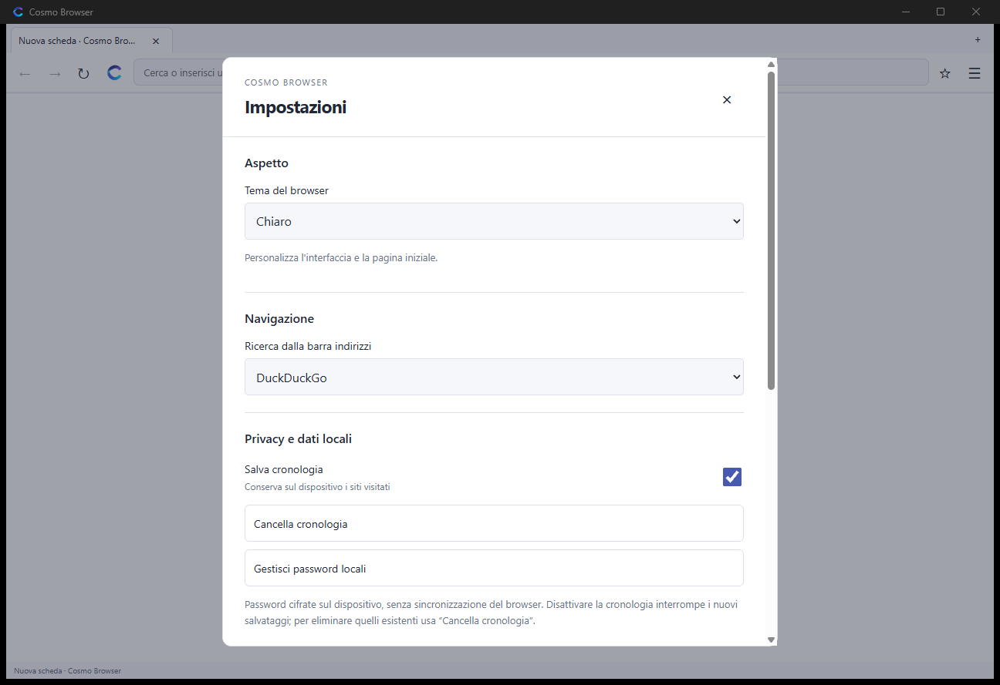

# Cosmo Browser 0.3.2 — Correzione Impostazioni

Pre-release correttiva per Windows x64 e Android 9+ ARM64.

## Problema corretto

Nella 0.3.1 il passaggio dal menu alle Impostazioni poteva mostrare soltanto l'intestazione, lasciando la pagina web davanti al resto del pannello. La chiusura del menu e una risposta nativa ritardata potevano riattivare la scheda durante l'apertura delle Impostazioni. Lo stesso problema poteva interessare password, cronologia e pannello degli aggiornamenti.

La 0.3.2 coordina il passaggio tra i pannelli e mantiene le schede native nascoste fino alla chiusura dell'ultimo pannello. Il blocco esiste anche nel codice nativo Android e Windows: una scheda creata o riattivata in ritardo non può tornare davanti alle Impostazioni.

## Aggiornare Android

Scaricare **`Cosmo-Browser-0.3.2-Android-arm64.apk`** dagli allegati e installarlo sopra l'app esistente, senza disinstallarla. Identificativo e firma personale restano quelli delle versioni precedenti; la versione è `0.3.2`, versionCode `3002`.

**Per questa correzione usare il file APK:** il difetto della 0.3.1 può coprire anche i comandi di aggiornamento nelle Impostazioni. Dopo l'installazione, aprire **Menu → Impostazioni** e verificare che il contenuto sia leggibile e scorrevole. Il controllo delle nuove release all'avvio resta disponibile; download e installazione richiedono un clic e la conferma Android.

## Allegati

| File | Uso |
| --- | --- |
| `Cosmo-Browser-0.3.2-Android-arm64.apk` | Android 9+ ARM64 |
| `Cosmo-Browser-0.3.2-Windows-x64-Setup.exe` | Installer Windows x64 |
| `Cosmo-Browser-Portable.exe` | Windows x64; richiede WebView2 presente |
| `README-Cosmo-Browser-0.3.2.md` | Questa guida |
| `SHA256SUMS` | Checksum di pacchetti e guida |

## Verifiche

La [build GitHub Actions](https://github.com/CosmoNetinfo/cosmonet-browser/actions/runs/46055964573) del commit `813cdcf2b1593e977f715780a5dc383bffc14370` è riuscita per entrambe le piattaforme. I pacchetti scaricati hanno checksum verificati; l'APK ha firma valida e lo stesso certificato delle release precedenti. Dimensioni: installer 1.664.310 byte, portable 4.853.248 byte, APK 7.379.827 byte.

Il test con risposta nativa ritardata falliva prima della correzione e passa con il nuovo codice. Verifica anche il passaggio tra pannelli, l'apertura di una scheda durante le Impostazioni e il ripristino della pagina alla chiusura del pannello. I test UI coprono larghezze da 360 a 1280 pixel e usano un ponte nativo simulato.

Il test Windows con WebView2 reale interroga la visibilità effettiva delle viste native: nessuna scheda visibile mentre Impostazioni o altri pannelli sono aperti, una scheda ripristinata dopo la chiusura. Questo controllo è distinto dalla sola verifica del DOM.

Il primo problema Android è stato documentato dallo screenshot dell'utente; la verifica della correzione sul suo telefono resta necessaria. Il test Windows non viene presentato come collaudo Android.

Restano disponibili modalità mobile/desktop, temi, preferiti, cronologia, password cifrate locali e aggiornamenti introdotti nella [0.3.1](https://github.com/CosmoNetinfo/cosmonet-browser/releases/tag/v0.3.1). Per istruzioni complete: [README](https://github.com/CosmoNetinfo/cosmonet-browser#readme).
